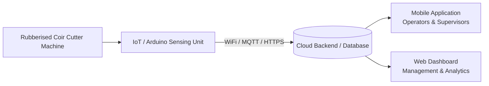

# Volume Monitoring Tool for Rubberised Coir Cutter Machine
### MCS4302 Mobile Computing Project

---

## 📌 Project Overview
This project presents an end-to-end IoT and Mobile Computing solution designed for **Toyo Cushion Lanka (Pvt) Ltd**, a member company of the **Hayleys Group**.

The primary objective is the **Development of a Volume Monitoring Tool for the Rubberised Coir Cutter Machine**, enabling automated, real-time tracking of coir block dimensions, cut volumes, production throughput, and scrap minimization through IoT-based sensor instrumentation and mobile computing technologies.

---

## 👥 Project Contributors
- **Sanjey Asirvatham**
- **Pasindu Silva**

**Course Module:** MCS4302 – Mobile Computing Project  
**Client / Industry Partner:** Toyo Cushion Lanka, Hayleys Group  

---

## 🎯 Problem Statement & Motivation
In rubberised coir manufacturing, precision in cutting coir sheets and blocks directly impacts product quality, material yield, and waste reduction. Traditional manual measurement methods are prone to operator variability, delayed reporting, and lack of real-time visibility into machine output and volumetric metrics.

This project bridges the gap by implementing:
- **Automated Physical Dimension & Volume Capture**: Utilizing IoT sensors installed on the cutter machine to measure physical dimensions and calculate instantaneous and batch volume.
- **Edge-to-Cloud Synchronization**: Seamless data transmission from the embedded controller to cloud services.
- **Mobile & Web Interfaces**: Real-time operational dashboards, cut logs, anomaly alerts, and productivity metrics for machine operators, floor supervisors, and plant managers.

---

## 🏗️ System Architecture



1. **Embedded / IoT Subsystem (`arduino/`)**:
   - Microcontroller (e.g., ESP32 / Arduino with network module) interfacing with distance, optical, or rotary encoder sensors.
   - Edge preprocessing to compute cut frequency, linear dimensions, and volumetric units.
   - Secure data transmission to cloud backends (e.g., Firebase / REST APIs).

2. **Mobile Subsystem (`mobile/`)**:
   - Cross-platform mobile app designed for factory floor supervisors and machine operators.
   - Live stream of volume metrics, batch progress, alert notifications (e.g., cut volume deviations, machine idle states), and shift reporting.

3. **Web Platform (`web/`)**:
   - Comprehensive managerial dashboard for historical reporting, performance analytics, batch tracking, user management, and calibration configuration.

---

## 📁 Repository Structure

```text
main-mobile-computing-project/
│
├── arduino/              # Microcontroller firmware, sensor drivers, and hardware schematics
│   └── README.md
│
├── mobile/               # Mobile application codebase (Flutter / React Native / Android)
│   └── README.md
│
├── web/                  # Web dashboard and analytics portal
│   └── README.md
│
└── README.md             # Project documentation (this file)
```

---

## 🚀 Getting Started

### 1. Embedded Firmware (`arduino/`)
- Navigate to [`arduino/`](./arduino/README.md)
- Requires [Arduino IDE](https://www.arduino.cc/en/software) or [PlatformIO](https://platformio.org/).
- Configure WiFi credentials and backend API/Firebase endpoints in the configuration file.

### 2. Mobile App (`mobile/`)
- Navigate to [`mobile/`](./mobile/README.md)
- Refer to the setup guide for installing dependencies and configuring environment keys.

### 3. Web Dashboard (`web/`)
- Navigate to [`web/`](./web/README.md)
- Refer to the web application documentation for local development server setup and build instructions.

---

## 📝 Git Commit Conventions

This project follows conventional commit guidelines to keep commit history clean, traceable, and consistent across all sub-modules.

### Format
```text
<type>(<scope>): <short description>
```
*Example: `feat(arduino): add ultrasonic sensor distance calibration logic`*

### Commit Types

| Type | Purpose |
| :--- | :--- |
| `feat` | Introduces a new feature |
| `fix` | Fixes a bug |
| `docs` | Documentation changes |
| `chore` | Maintenance or configuration changes |
| `refactor` | Code restructuring without changing functionality |
| `test` | Adds or modifies tests |
| `style` | Formatting changes |

---

## 📜 License & Acknowledgements
Developed as part of the MCS4302 Mobile Computing Project curriculum. Special thanks to the engineering and operations teams at **Toyo Cushion Lanka, Hayleys Group** for industry guidance, domain access, and operational requirements.

